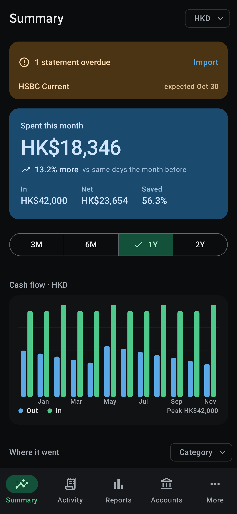
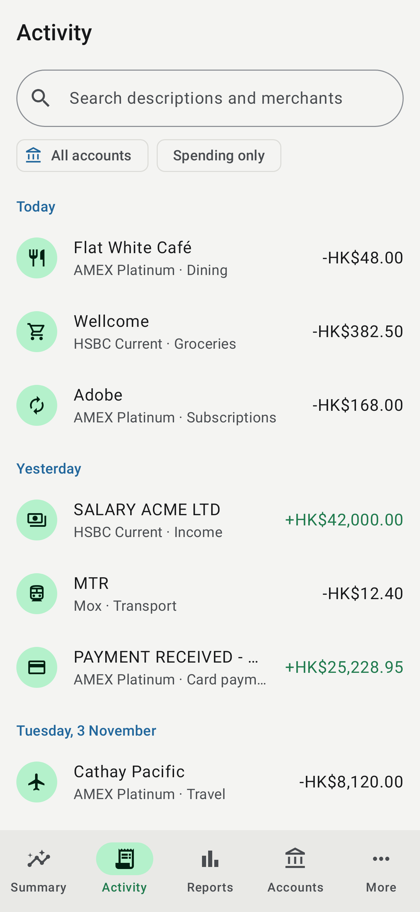
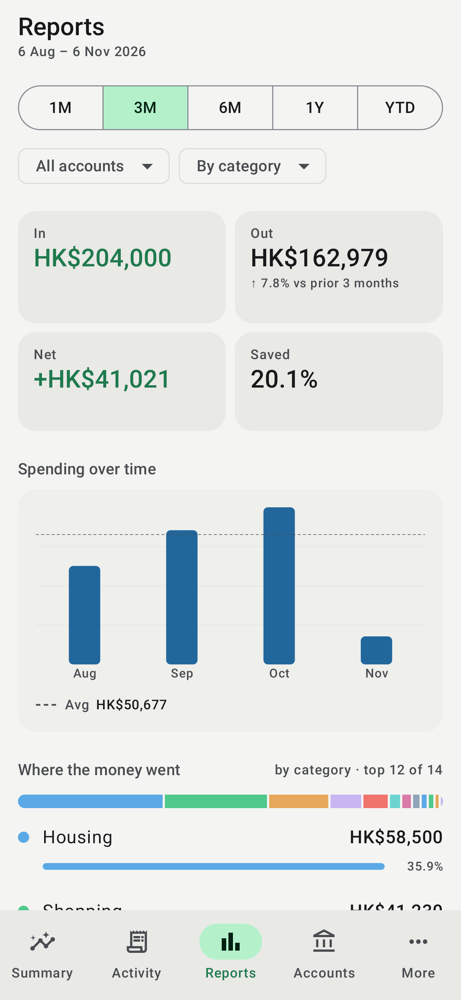
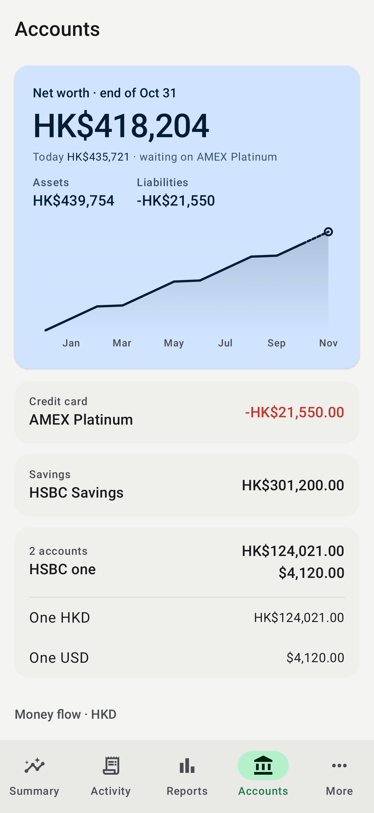
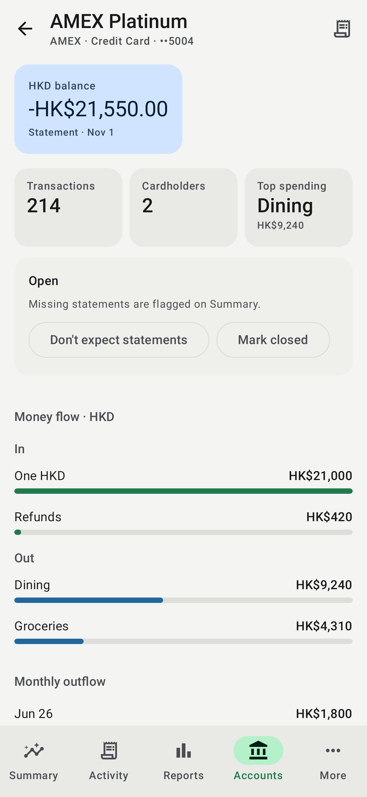
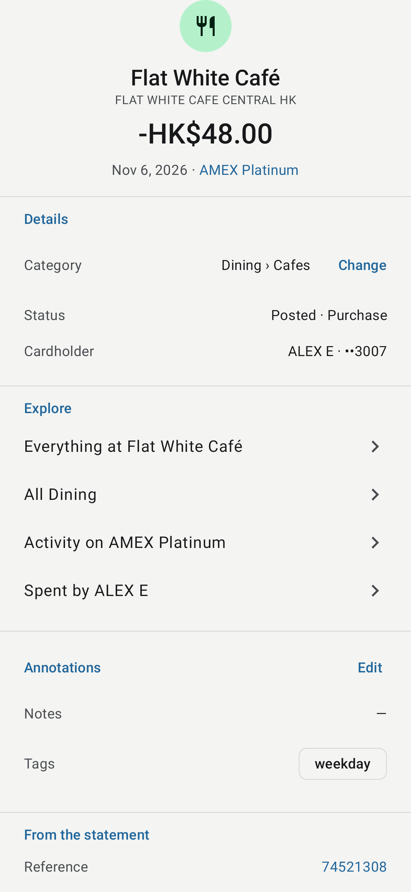
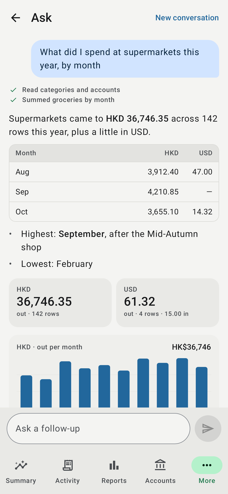
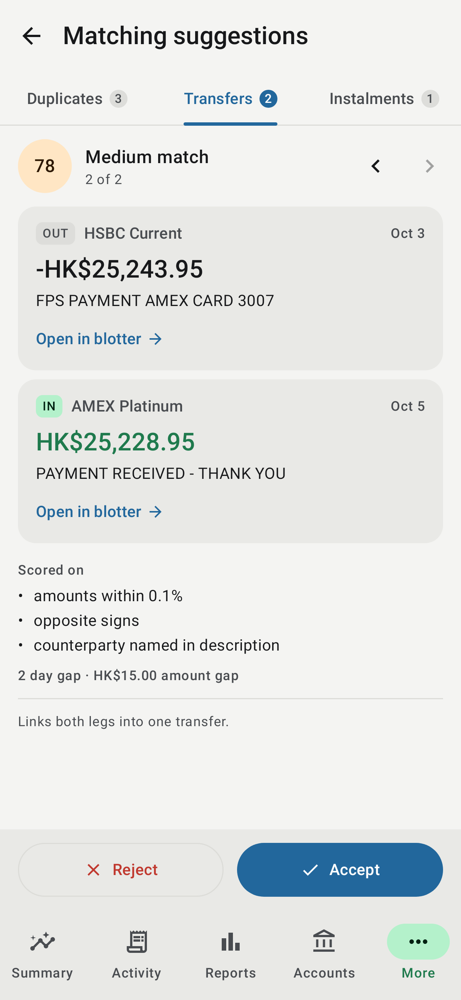

# Finto for Android

A native Android client for the Finto ledger, written in Kotlin with Jetpack
Compose and Material 3. It talks to the same FastAPI server as the web app,
signs in with the same accounts, and shows the same figures.

| Summary | Activity | Reports | Accounts |
| --- | --- | --- | --- |
|  |  |  |  |

| Account | Transaction | Ask | Matching suggestions |
| --- | --- | --- | --- |
|  |  |  |  |

## What it does

Everything the web app does, laid out the same way: Summary, Activity,
Reports and Accounts in the navigation bar, and the rest under More,
grouped as on the web.

- **Summary**: spending this month against the same days of the month
  before, anchored on the last day the ledger reaches; In, Net and Saved;
  overdue statements; monthly cash flow; spending split by any dimension, in
  any reporting currency. Every figure opens the rows behind it.
- **Activity**: the blotter, paged and grouped by day, with search and
  filters. A row's details show every fact from the statement and each one
  opens the rows that share it. Edit the category (with the model's
  suggestion), merchant, notes, tags and review state; long-press a row to
  categorise it straight away.
- **Reports**: In, Out, Net and Saved for 1M to YTD against the prior
  period, a monthly chart with its average, months you can select, and where
  the money went, split by category, merchant, tag, cardholder and more.
- **Accounts**: net worth as of the last day every statement covers, and
  today's; assets and liabilities; a net-worth line; products grouped by
  balance group. Each account has its own page: balances, whether
  statements are expected (watch, close, reopen), money flow, monthly
  outflow, cards, cardholders, transfers and recent activity.
- **More**
  - Money: **Recurring** (subscriptions by cadence, what is committed each
    month, instalment plans) and **Ask** (questions in plain language,
    answered as the ledger's tools run, with figures, charts and rows).
  - Ledger: **Import** (preview, confirm, the post-import review, history,
    maintenance; share a statement to Finto from any app), **Instalments**
    (plans and their schedules) and **Investments** (valuations, holdings,
    contributions, MPF statement import).
  - Ledger health: **Matching suggestions** (duplicates, transfers and
    instalment runs to accept or reject), **Integrity** (balance checks and
    structural violations) and **Timeline** (spending composition by month,
    statement coverage).
  - **Settings**: reporting currency, theme, language (English or
    Traditional Chinese, as the web translates), dynamic colour, API keys,
    sign out.

Reads are answered from the HTTP cache first and then from the server, so
screens open with the last figures at once and refresh behind them.

## Architecture

The structure follows Google's
[Now in Android](https://github.com/android/nowinandroid) guidance:
unidirectional data flow, a repository layer, and modules split by layer and
feature.

```text
app/                    Activity, splash, adaptive navigation shell, Hilt entry point
core/model/             API models, money formatting, hero anchor, ranking (pure Kotlin, JVM tests)
core/network/           Retrofit + OkHttp, persistent session cookie, server switching
core/data/              Repositories, Paging source, DataStore settings, error messages
core/designsystem/      Material 3 theme (dynamic colour + Finto palette), shared components
core/testing/           Fakes and rules for unit tests
feature/auth/           Sign-in, including the public demo
feature/summary/        Summary
feature/transactions/   Activity (blotter), transaction details and editing
feature/reports/        Reports and Timeline
feature/accounts/       Accounts, net worth, account and product pages
feature/recurring/      Recurring and Instalments
feature/investments/    Investments and MPF import
feature/health/         Matching suggestions and Integrity
feature/ask/            Ask
feature/imports/        Statement import, review, history and maintenance
feature/settings/       Settings and API keys
build-logic/            Gradle convention plugins shared by every module
```

Each feature exposes a type-safe navigation destination, a Hilt `ViewModel`
that publishes one immutable UI state as a `StateFlow`, and a stateless
screen composable. The stateless screens are what the screenshot tests
render.

Stack: Kotlin 2.4, AGP 9.5, Gradle 9.8, Compose BOM 2026.09, Material 3 with
the adaptive navigation suite (bottom bar on phones, rail on tablets), Hilt,
Navigation Compose with serializable routes, Paging 3, DataStore, Retrofit 3,
OkHttp 5 and kotlinx.serialization. `minSdk` 29, `targetSdk` 36, `compileSdk` 37.

### Sessions and privacy

The app uses the server's existing session cookie (`finto_session`), so the
API needs no changes for it. The cookie is kept in the app's no-backup
directory. Backups and device-to-device transfer are disabled. Release builds
only speak HTTPS. Debug builds may also reach a local development server over
plain HTTP at `10.0.2.2` (the emulator's address for your computer),
`localhost` or `127.0.0.1`.

## Build and run

Requirements: JDK 21 and the Android SDK, with `sdk.dir` set in
`local.properties` or `ANDROID_HOME` set.

```bash
./gradlew assembleDebug
```

```bash
adb install app/build/outputs/apk/debug/app-debug.apk
```

The debug build installs as `page.zepto.finto.debug`, beside a release build.
To try it without an account, tap **Try the demo** on the sign-in screen.

Debug builds are slow by design (no R8, debuggable Compose). To judge real
speed, install the `preview` build: release code signed with the debug key,
installed as `page.zepto.finto.preview`.

```bash
./gradlew assemblePreview
```

To use a local server, run the API from the repository root and sign in to
`http://10.0.2.2:8000` from the emulator:

```bash
.venv/bin/uvicorn fin.api.app:app --reload --port 8000
```

### Release builds

`assembleRelease` shrinks and obfuscates with R8. It signs only when a
keystore is supplied, as Gradle properties (`finto.signing.storeFile`,
`finto.signing.storePassword`, `finto.signing.keyAlias`,
`finto.signing.keyPassword`) or as the environment variables
`FINTO_SIGNING_STORE_FILE`, `FINTO_SIGNING_STORE_PASSWORD`,
`FINTO_SIGNING_KEY_ALIAS` and `FINTO_SIGNING_KEY_PASSWORD`. Without them the
APK is left unsigned. No key material belongs in the repository.

## Tests

```bash
./gradlew testDebugUnitTest lintDebug
```

- `core:model` decodes responses captured from the public demo server
  (`src/test/resources/fixtures`, invented data only). It also checks money
  formatting, ranking, and the Summary anchor against the same cases as the
  web app's `hero-anchor.spec.ts`.
- The feature modules test their view models against the fakes in
  `core:testing`.
- `app` renders every screen with Robolectric and Roborazzi. Record the images
  into `app/build/outputs/roborazzi/` with:

  ```bash
  ./gradlew :app:recordRoborazziDebug
  ```

- An opt-in test runs the app's real API client against a live server: sign
  in, read, filter, page, convert, sign out. It uses only the demo's published
  credentials:

  ```bash
  ./gradlew :core:network:testDebugUnitTest -Pfinto.liveServer=https://demo.finto.zepto.page
  ```

CI (`.github/workflows/android.yml`) runs the build, unit tests, lint and
screenshots when `android/` changes. It uploads the debug and preview APKs
and the screenshots as workflow artifacts.
