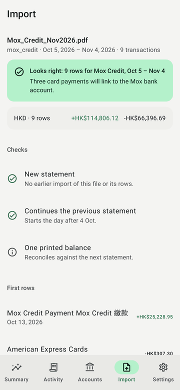

# Finto for Android

A native Android client for the Finto ledger, written in Kotlin with Jetpack
Compose and Material 3. It talks to the same FastAPI server as the web app,
signs in with the same accounts, and shows the same figures.

| Summary | Activity | Accounts | Import |
| --- | --- | --- | --- |
|  |  |  |  |

## What it does

- **Summary**: spending this month against the same days of the month
  before, anchored on the last day the ledger actually reaches, as on the web.
  Income and savings rate, overdue statements, a monthly in/out chart, and
  spending ranked by category in your reporting currency. Tap a category to
  open its transactions.
- **Activity**: the blotter, paged and grouped by day, with search, an
  account filter and a spending-only filter. Tap a row for its details:
  card, category, foreign amount and rate, tags, notes, the statement's own
  facts and the file it came from.
- **Accounts**: net worth in the reporting currency, then each account and
  currency with its balance and where that balance comes from (a printed
  statement, a valuation, or the running total of imported rows).
- **Import**: pick a PDF or CSV, or share one to Finto from a bank's app,
  Files or Gmail. The server previews it (parser, period, totals, checks
  against the ledger, the analysis model's verdict, the first rows) and
  nothing is written until you confirm.
- **Settings**: reporting currency (saved to your account), light, dark or
  system theme, Material You dynamic colour, sign out.

Reports, review queues, investments and Ask stay in the web app for now.

## Architecture

The structure follows Google's
[Now in Android](https://github.com/android/nowinandroid) guidance:
unidirectional data flow, a repository layer, and modules split by layer and
feature.

```text
app/                    Activity, splash, adaptive navigation shell, Hilt entry point
core/model/             API models, money formatting, hero anchor, ranking (pure Kotlin, JVM tests)
core/network/           Retrofit + OkHttp, persistent session cookie, server switching
core/data/              Repositories, Paging source, DataStore settings, error messages
core/designsystem/      Material 3 theme (dynamic colour + Finto palette), shared components
core/testing/           Fakes and rules for unit tests
feature/auth/           Sign-in, including the public demo
feature/summary/        Summary screen
feature/transactions/   Activity (blotter) and transaction details
feature/accounts/       Accounts and net worth
feature/imports/        Statement preview and import
feature/settings/       Settings
build-logic/            Gradle convention plugins shared by every module
```

Each feature exposes a type-safe navigation destination, a Hilt `ViewModel`
that publishes one immutable UI state as a `StateFlow`, and a stateless
screen composable. The stateless screens are what the screenshot tests
render.

Stack: Kotlin 2.4, AGP 9.5, Gradle 9.8, Compose BOM 2026.09, Material 3 with
the adaptive navigation suite (bottom bar on phones, rail on tablets), Hilt,
Navigation Compose with serializable routes, Paging 3, DataStore, Retrofit 3,
OkHttp 5 and kotlinx.serialization. `minSdk` 29, `targetSdk` 36, `compileSdk` 37.

### Sessions and privacy

The app uses the server's existing session cookie (`finto_session`), so the
API needs no changes for it. The cookie is kept in the app's no-backup
directory. Backups and device-to-device transfer are disabled. Release builds
only speak HTTPS. Debug builds may also reach a local development server over
plain HTTP at `10.0.2.2` (the emulator's address for your computer),
`localhost` or `127.0.0.1`.

## Build and run

Requirements: JDK 21 and the Android SDK, with `sdk.dir` set in
`local.properties` or `ANDROID_HOME` set.

```bash
./gradlew assembleDebug
```

```bash
adb install app/build/outputs/apk/debug/app-debug.apk
```

The debug build installs as `page.zepto.finto.debug`, beside a release build.
To try it without an account, tap **Explore the demo** on the sign-in screen.

To use a local server, run the API from the repository root and sign in to
`http://10.0.2.2:8000` from the emulator:

```bash
.venv/bin/uvicorn fin.api.app:app --reload --port 8000
```

### Release builds

`assembleRelease` shrinks and obfuscates with R8. It signs only when a
keystore is supplied, as Gradle properties (`finto.signing.storeFile`,
`finto.signing.storePassword`, `finto.signing.keyAlias`,
`finto.signing.keyPassword`) or as the environment variables
`FINTO_SIGNING_STORE_FILE`, `FINTO_SIGNING_STORE_PASSWORD`,
`FINTO_SIGNING_KEY_ALIAS` and `FINTO_SIGNING_KEY_PASSWORD`. Without them the
APK is left unsigned. No key material belongs in the repository.

## Tests

```bash
./gradlew testDebugUnitTest lintDebug
```

- `core:model` decodes responses captured from the public demo server
  (`src/test/resources/fixtures`, invented data only). It also checks money
  formatting, ranking, and the Summary anchor against the same cases as the
  web app's `hero-anchor.spec.ts`.
- The feature modules test their view models against the fakes in
  `core:testing`.
- `app` renders every screen with Robolectric and Roborazzi. Record the images
  into `app/build/outputs/roborazzi/` with:

  ```bash
  ./gradlew :app:recordRoborazziDebug
  ```

- An opt-in test runs the app's real API client against a live server: sign
  in, read, filter, page, convert, sign out. It uses only the demo's published
  credentials:

  ```bash
  ./gradlew :core:network:testDebugUnitTest -Pfinto.liveServer=https://demo.finto.zepto.page
  ```

CI (`.github/workflows/android.yml`) runs the build, unit tests, lint and
screenshots when `android/` changes. It uploads the debug APK and the
screenshots as workflow artifacts.
